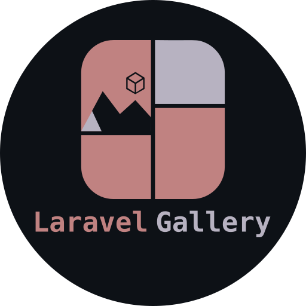

<p align="center">
  
</p>

[](https://packagist.org/packages/jgawlik/laravel-gallery)
[](https://packagist.org/packages/jgawlik/laravel-gallery)

Image gallery package for Laravel applications. Drop it into any Laravel project
to get galleries and image uploads via a clean, modern API.

## Features

- Gallery CRUD API endpoints
- Multiple image uploads per gallery
- Automatic thumbnail generation (inline or queued) with a backfill command
- Configurable storage disk and path
- Automatic file cleanup on deletion
- Database migrations and model factories
- Full Pest test suite targeting 100% coverage
- PHPStan level 7 and Laravel Pint enforcement

## Requirements

- PHP ^8.3
- Laravel ^13.0
- The GD or Imagick PHP extension, for thumbnail generation

## Installation

Install the package via Composer:

```bash
composer require jgawlik/laravel-gallery
```

The service provider will be auto-discovered by Laravel.

## Configuration

Publish the config file:

```bash
php artisan vendor:publish --tag=gallery-config
```

The default config is:

```php
return [
    'disk' => env('GALLERY_DISK', 'public'),
    'path' => env('GALLERY_PATH', 'galleries'),
    'middleware' => ['api', 'auth'],
    'thumbnails' => [
        'enabled' => env('GALLERY_THUMBNAILS', true),
        'width' => env('GALLERY_THUMBNAIL_WIDTH', 800),
        'height' => env('GALLERY_THUMBNAIL_HEIGHT', 450),
        'format' => env('GALLERY_THUMBNAIL_FORMAT', 'webp'),
        'quality' => env('GALLERY_THUMBNAIL_QUALITY', 75),
        'path' => env('GALLERY_THUMBNAIL_PATH', 'thumbs'),
        'queue' => env('GALLERY_THUMBNAILS_QUEUE', false),
    ],
];
```

The default disk is `public`, so make sure the storage link exists:

```bash
php artisan storage:link
```

The `middleware` value controls route-level protection. If your app is API-only
(e.g. Sanctum), change it to `['api', 'auth:sanctum']` or any middleware your
project uses:

```php
'middleware' => ['api', 'auth:sanctum'],
```

Run the migrations:

```bash
php artisan migrate
```

## Usage

### API Endpoints

All gallery routes are authenticated by default. Galleries and images created
through the API are owned by the authenticated user, and the default policies
respond with a 404 when anyone else tries to view or modify them, so records
can't be probed.

Ownership is enforced entirely through policies — route model binding is
deliberately left unscoped. To expose galleries publicly (for example a
guest-facing portfolio), register your own policy in a service provider and
adjust the route middleware via the `gallery.middleware` config:

```php
use Illuminate\Support\Facades\Gate;
use Jgawlik\LaravelGallery\Models\Gallery;

Gate::policy(Gallery::class, YourGalleryPolicy::class);
```

| Method    | Endpoint                                     | Description                |
| --------- | -------------------------------------------- | -------------------------- |
| GET       | `/api/v1/galleries`                          | List all galleries         |
| POST      | `/api/v1/galleries`                          | Create a gallery           |
| GET       | `/api/v1/galleries/{gallery}`                | Show a gallery             |
| PUT/PATCH | `/api/v1/galleries/{gallery}`                | Update a gallery           |
| DELETE    | `/api/v1/galleries/{gallery}`                | Delete a gallery           |
| POST      | `/api/v1/galleries/{gallery}/images`         | Upload images to a gallery |
| PUT/PATCH | `/api/v1/galleries/{gallery}/images/{image}` | Update a gallery image     |
| DELETE    | `/api/v1/galleries/{gallery}/images/{image}` | Delete a gallery image     |

### Creating a Gallery

```bash
curl -X POST http://your-app.test/api/v1/galleries \
  -H "Accept: application/json" \
  -F "name=Summer Photos" \
  -F "description=A simple gallery" \
  -F "image=@cover.jpg"
```

### Uploading Images

```bash
curl -X POST http://your-app.test/api/v1/galleries/1/images \
  -H "Accept: application/json" \
  -F "images[]=@photo1.jpg" \
  -F "images[]=@photo2.jpg"
```

Each image in the response carries the original and its thumbnail:

```json
{
  "id": 1,
  "path": "galleries/abc123.jpg",
  "url": "/storage/galleries/abc123.jpg",
  "width": 4000,
  "height": 3000,
  "thumbnail_url": "/storage/galleries/thumbs/def456.webp",
  "thumbnail_width": 800,
  "thumbnail_height": 450,
  "title": "Sunset",
  "description": null,
  "alt_text": null,
  "sort_order": 1
}
```

Use `thumbnail_url` (with `thumbnail_width`/`thumbnail_height`) in grids and
`url` in lightboxes. When an image has no thumbnail yet, the `thumbnail_*`
fields fall back to the original so templates never need a null check.

### Thumbnails

Every uploaded image gets a thumbnail generated through Laravel's `Image`
facade: the original is EXIF-oriented, cover-cropped to the configured
dimensions and encoded in the configured format. Thumbnails live next to the
originals in the `thumbnails.path` sub-directory (`galleries/thumbs` by
default) and are deleted together with the image.

Thumbnail generation requires `intervention/image`, which this package pulls
in, plus the GD or Imagick extension. Pick the driver via Laravel's
`config/images.php` (`gd` by default).

To move the work off the request, set `thumbnails.queue` to `true` and the
`GenerateGalleryThumbnail` job is dispatched after the upload commits:

```php
'thumbnails' => [
    'queue' => true,
],
```

A failed thumbnail never fails the upload: the exception is reported, the
image is saved without a thumbnail and the API falls back to the original.
Generate the missing ones later (for example after enabling the feature on an
existing install, or after changing the dimensions) with:

```bash
php artisan gallery:thumbnails           # images without a thumbnail
php artisan gallery:thumbnails --force   # regenerate all thumbnails
php artisan gallery:thumbnails --queue   # dispatch a job per image instead
```

Set `thumbnails.enabled` to `false` to skip generation entirely.

### Storing images from your own code

The upload logic lives in the invokable `StoreGalleryImage` action, so admin
panels or importers can store images with exactly the same behaviour as the
API endpoint (file storage, dimension detection, thumbnail generation):

```php
use Jgawlik\LaravelGallery\Actions\StoreGalleryImage;

$image = app(StoreGalleryImage::class)($gallery, $request->file('photo'), [
    'title' => 'Sunset',
    'alt_text' => 'The sun setting over the sea',
]);
```

`sort_order` is appended to the end of the gallery when omitted. To
(re)generate a single thumbnail, invoke `GenerateThumbnail` with the image.

## Testing

```bash
composer test
```

With coverage (requires [PCOV](https://pecl.php.net/package/pcov) or
[Xdebug](https://xdebug.org)):

```bash
composer test:coverage
```

Or use Make:

```bash
make test-coverage
```

## Static Analysis & Formatting

```bash
composer analyse   # PHPStan
composer format    # Laravel Pint
composer lint      # Both
```

Or use Make:

```bash
make lint
```

## Changelog

Please see [CHANGELOG](CHANGELOG.md) for more information.

## Contributing

Please see [CONTRIBUTING](CONTRIBUTING.md) for details.

## License

The MIT License (MIT). Please see [LICENSE](LICENSE) for more information.
